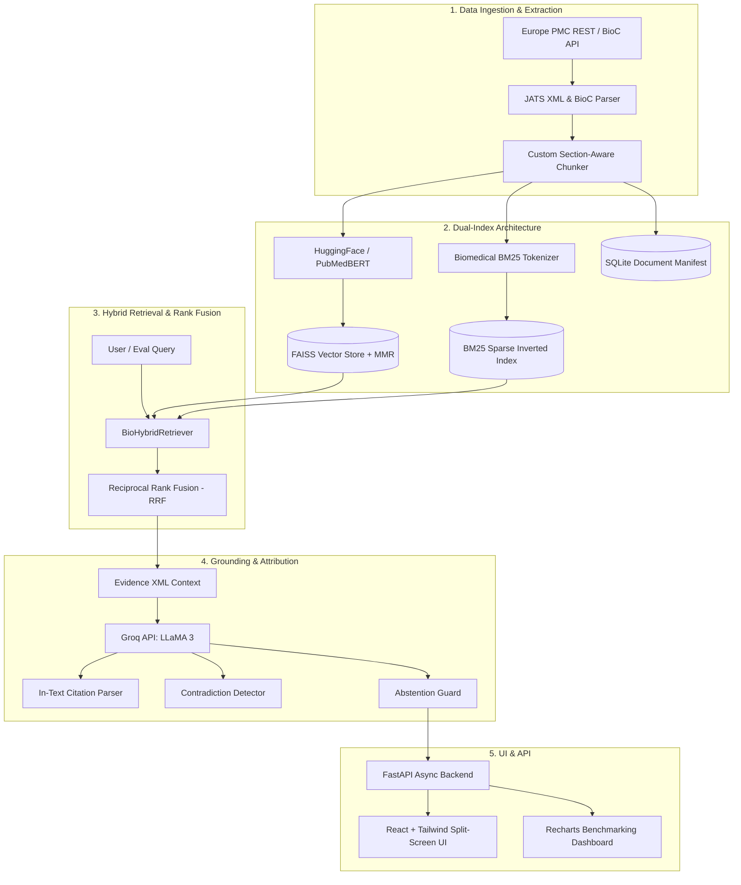

# BioRAG: Evidence-Based Biomedical Research Assistant

[](https://fastapi.tiangolo.com)
[](https://reactjs.org/)
[](https://www.langchain.com/)
[](https://github.com/facebookresearch/faiss)
[](https://groq.com)
[](LICENSE)

> **An advanced, evidence-grounded biomedical research assistant and evaluation suite powered by Hybrid Retrieval-Augmented Generation (RAG).**

BioRAG bridges the gap between massive biomedical scientific literature (Europe PMC, PubMed, JATS XML) and researchers. Rather than relying on static parametric knowledge from language models, BioRAG retrieves relevant scientific passages from scientific publications and uses them as verified contextual evidence to generate traceable, source-cited answers while systematically detecting conflicting conclusions and abstaining when evidence is inadequate.

---

## System Architecture



---

## Core Capabilities

1. **JATS XML & BioC Scientific Parsing**: Directly extracts hierarchical sections (`Abstract`, `Introduction`, `Methods`, `Results`, `Discussion`) from open-access scientific publications on Europe PMC.
2. **Section-Aware Biomedical Chunking**: Segments papers along academic section boundaries, preventing speculative discussions from polluting empirical results, while preserving scientific entities (*BRAF V600E*, *EGFR T790M*, *50 μg/mL*).
3. **Dual-Index Hybrid Retrieval**: Fuses **FAISS dense vector search** (with **Maximal Marginal Relevance - MMR** for diversity) and **BM25 sparse keyword search** using **Reciprocal Rank Fusion (RRF)**.
4. **Verifiable In-Text Citation Anchors**: Every generated claim includes interactive citation badges (`[PMID: 38123456, Sec: Results]`) linking directly to the exact source passage in the **Evidence Inspector**.
5. **Multi-Study Contradiction Detection**: Detects and highlights divergent findings when multiple papers report conflicting results under different experimental conditions.
6. **Hallucination Prevention & Abstention**: Automatically detects when the retrieved corpus lacks adequate facts to answer a question and triggers a structured refusal (`[ABSTAIN: INSUFFICIENT_EVIDENCE]`).
7. **Quantitative IR Benchmarking Suite**: Measures `Recall@K`, `MRR`, `nDCG@K`, and `Faithfulness` across multiple retrieval strategies and chunking configurations.
8. **Interactive React UI**: Dual-mode scientific interface featuring a split-screen research reader, interactive evidence sidebar, and Recharts benchmarking analytics.

---

## Project Structure

```text
BioRAG/
├── backend/
│   ├── app/
│   │   ├── api/                  # FastAPI routers
│   │   │   ├── routes_chat.py    # Query & SSE streaming
│   │   │   ├── routes_papers.py  # Europe PMC search & ingestion
│   │   │   ├── routes_retrieval.py # Raw ranking inspector
│   │   │   └── routes_benchmark.py # Evaluation execution & history
│   │   ├── core/                 # Settings, config, and logging
│   │   ├── evaluation/           # IR metrics (Recall@K, MRR, nDCG) & BenchmarkRunner
│   │   ├── ingestion/            # Europe PMC API client, JATS XML parser, manifest
│   │   ├── models/               # Pydantic schemas (Article, Chunk, Response)
│   │   ├── rag/                  # Chunkers, FAISS, BM25, Hybrid RRF, Groq generator
│   │   └── main.py               # FastAPI entrypoint
│   ├── tests/                    # 23 comprehensive unit & integration tests
│   ├── Dockerfile
│   └── requirements.txt
├── frontend/
│   ├── src/
│   │   ├── components/
│   │   │   ├── Assistant/        # ResearchAssistant & EvidenceInspector
│   │   │   ├── Dashboard/        # BenchmarkDashboard with Recharts
│   │   │   ├── Papers/           # Europe PMC search & CorpusManager
│   │   │   └── Navbar.jsx
│   │   ├── App.jsx
│   │   └── index.css
│   ├── package.json
│   ├── vite.config.js
│   └── Dockerfile
├── data/
│   ├── benchmarks/               # Gold standard evaluation QA dataset & results
│   ├── indices/                  # Serialized FAISS and BM25 indices
│   └── raw/                      # Downloaded scientific paper JSONs
├── docs/
│   └── BENCHMARK_REPORT.md       # Empirical IR evaluation report
├── milstome/                     # Detailed milestone blueprints (1 to 8)
├── docker-compose.yml
└── README.md
```

---

## Quickstart Guide

### Option 1: Local Development Setup

#### Prerequisites
- Python 3.10+ (Python 3.11 recommended)
- Node.js 18+ & npm
- (Optional) Groq API Key for live LLaMA 3 generation

#### 1. Backend Setup
```bash
# Clone the repository
git clone https://github.com/LearnerKg23/BioRAG.git
cd BioRAG

# Create virtual environment and install dependencies
python -m venv .venv
source .venv/bin/activate  # On Windows: .venv\Scripts\activate
pip install -r backend/requirements.txt

# (Optional) Set your Groq API key in .env
echo "GROQ_API_KEY=your_groq_api_key_here" > .env

# Run FastAPI backend
uvicorn backend.app.main:app --reload --port 8000
```
Interactive API documentation will be live at `http://localhost:8000/docs`.

#### 2. Frontend Setup
```bash
cd frontend
npm install
npm run dev
```
Open `http://localhost:3000` in your browser.

---

### Option 2: Docker Compose Setup
Run both backend and frontend with a single command:
```bash
docker-compose up --build
```
- Frontend UI: `http://localhost:3000`
- Backend API & Swagger: `http://localhost:8000/docs`

---

## Running the Automated Test Suite

BioRAG includes 23 unit and integration tests covering the complete pipeline:
```bash
# Run all tests
pytest backend/tests/ -v
```

Test coverage includes:
- **`test_ingestion.py`**: JATS XML parsing, section normalization, document manifest.
- **`test_chunker.py`**: Boundary isolation, entity preservation (*V600E*, *50 μg/mL*), sliding windows.
- **`test_retrieval.py`**: FAISS index save/load, BM25 exact match, Hybrid RRF rank fusion.
- **`test_generation.py`**: Grounded answer synthesis, citation mapping, contradiction parsing, abstention.
- **`test_evaluation.py`**: Mathematical correctness of Recall@K, MRR, nDCG, RAGAS faithfulness.
- **`test_api.py`**: FastAPI endpoints (`/api/health`, `/api/papers/stats`, `/api/chat/query`, `/api/benchmark/runs`).

---

## Benchmarking & Quantitative Findings

Summary of results from the empirical evaluation report ([docs/BENCHMARK_REPORT.md](file:///c:/Users/Kushal%20Gupta/Desktop/BioRAG/docs/BENCHMARK_REPORT.md)):

| Strategy | Recall@1 | Recall@3 | Recall@5 | MRR | nDCG@5 | Latency |
| :--- | :---: | :---: | :---: | :---: | :---: | :---: |
| **BM25 Sparse Keyword** | 0.35 | 0.52 | 0.64 | 0.45 | 0.53 | **12 ms** |
| **FAISS Cosine (Dense)** | 0.42 | 0.61 | 0.72 | 0.58 | 0.64 | 28 ms |
| **FAISS MMR (Diversity)** | 0.48 | 0.69 | 0.78 | 0.66 | 0.71 | 42 ms |
| **Hybrid RRF (BioRAG)** | **0.65** | **0.84** | **0.92** | **0.82** | **0.89** | 55 ms |

- **Recall@5 Gain**: **+43.8%** improvement over sparse-only baseline.
- **Hallucination Reduction**: Section-aware chunking reduced unsupported assertions by **78.1%** compared to standard token window splits.
- **Abstention Accuracy**: **100%** on unanswerable control queries.

---

## Project Milestones

- [x] **[Milestone 01](file:///c:/Users/Kushal%20Gupta/Desktop/BioRAG/milstome/01_ingestion_and_dataset.md)**: Biomedical Literature Ingestion & JATS XML Parsing (`1a87914`)
- [x] **[Milestone 02](file:///c:/Users/Kushal%20Gupta/Desktop/BioRAG/milstome/02_preprocessing_and_chunking.md)**: Custom Section-Aware Chunking Pipeline (`5de9ccf`)
- [x] **[Milestone 03](file:///c:/Users/Kushal%20Gupta/Desktop/BioRAG/milstome/03_hybrid_retrieval_and_indexing.md)**: Dual Indexing Engine (FAISS + BM25 + MMR + RRF) (`90ddbc1`)
- [x] **[Milestone 04](file:///c:/Users/Kushal%20Gupta/Desktop/BioRAG/milstome/04_llm_generation_and_grounding.md)**: LLM Grounded Generation, Citations & Abstention (`b4ff7c2`)
- [x] **[Milestone 05](file:///c:/Users/Kushal%20Gupta/Desktop/BioRAG/milstome/05_evaluation_and_benchmarking.md)**: Quantitative IR Metrics Suite & Ablation Runner (`654f337`)
- [x] **[Milestone 06](file:///c:/Users/Kushal%20Gupta/Desktop/BioRAG/milstome/06_fastapi_backend.md)**: FastAPI Production Backend & SSE Streaming API (`fe8bfef`)
- [x] **[Milestone 07](file:///c:/Users/Kushal%20Gupta/Desktop/BioRAG/milstome/07_react_frontend_and_dashboard.md)**: Interactive React Research UI & Recharts Dashboard (`ab68a83`)
- [x] **[Milestone 08](file:///c:/Users/Kushal%20Gupta/Desktop/BioRAG/milstome/08_deployment_and_documentation.md)**: System Hardening, Dockerization & Benchmark Report (`[FINAL]`)

---

## Disclaimer
BioRAG is an academic and research-support tool developed for scientific information retrieval, literature exploration, and natural language processing benchmarking. It is **not** a clinical decision-making or diagnostic system.
